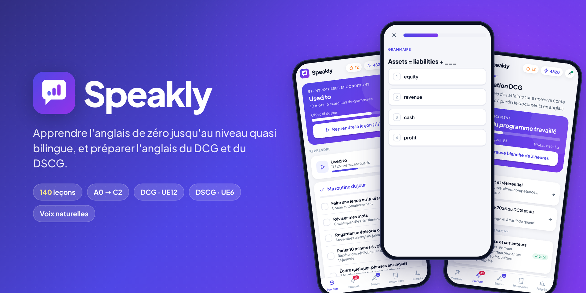
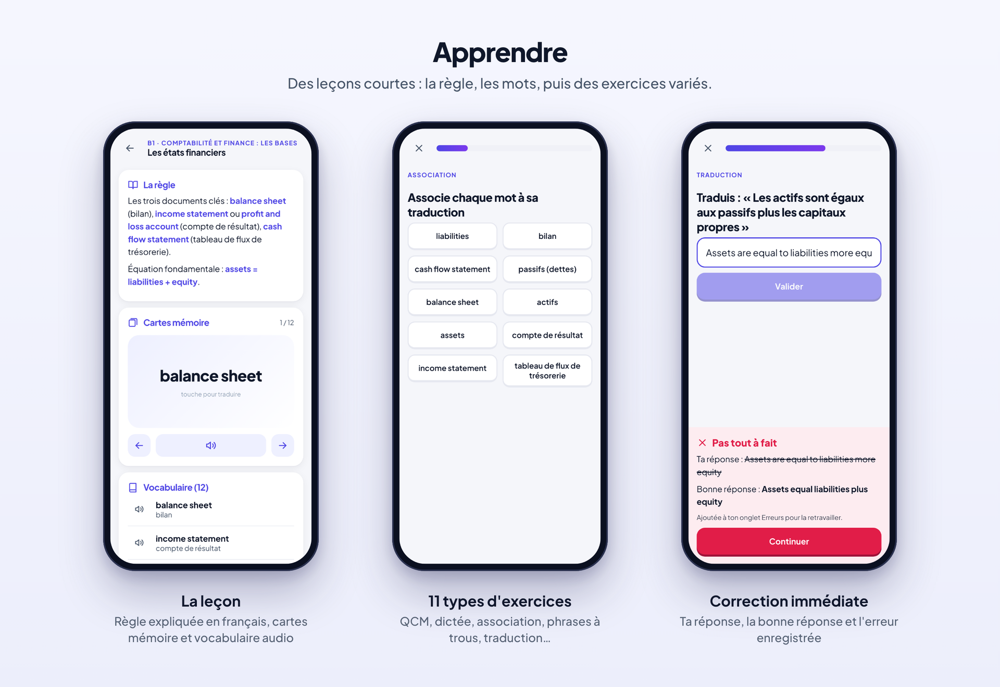
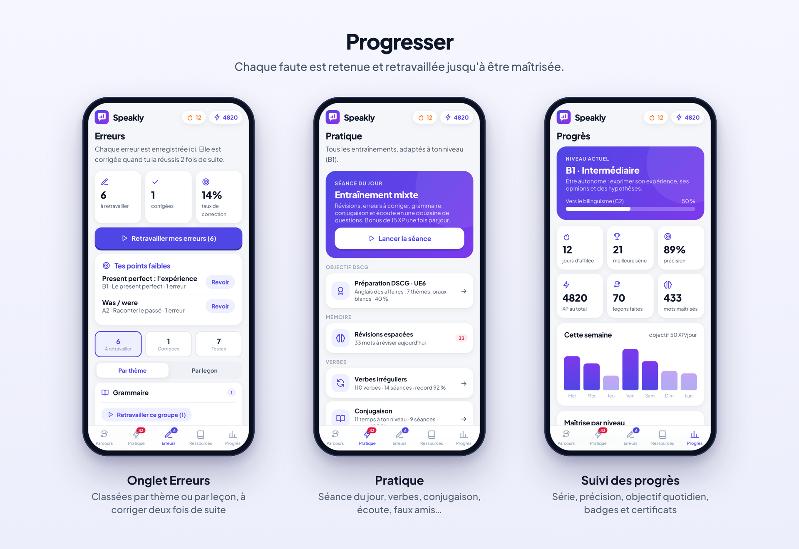
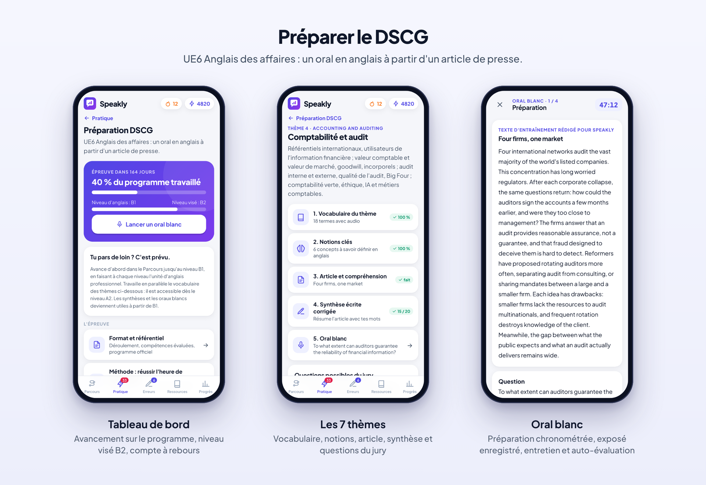
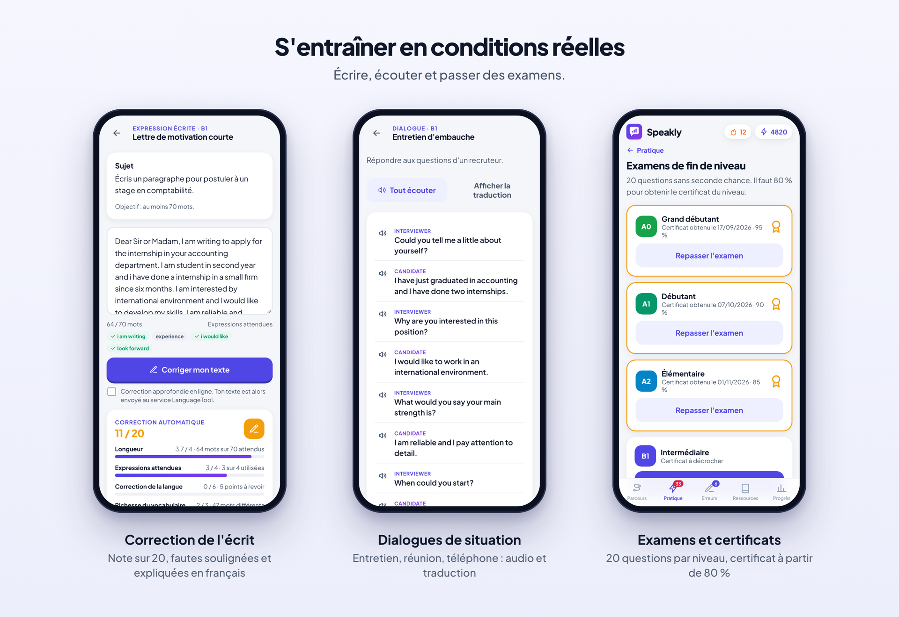
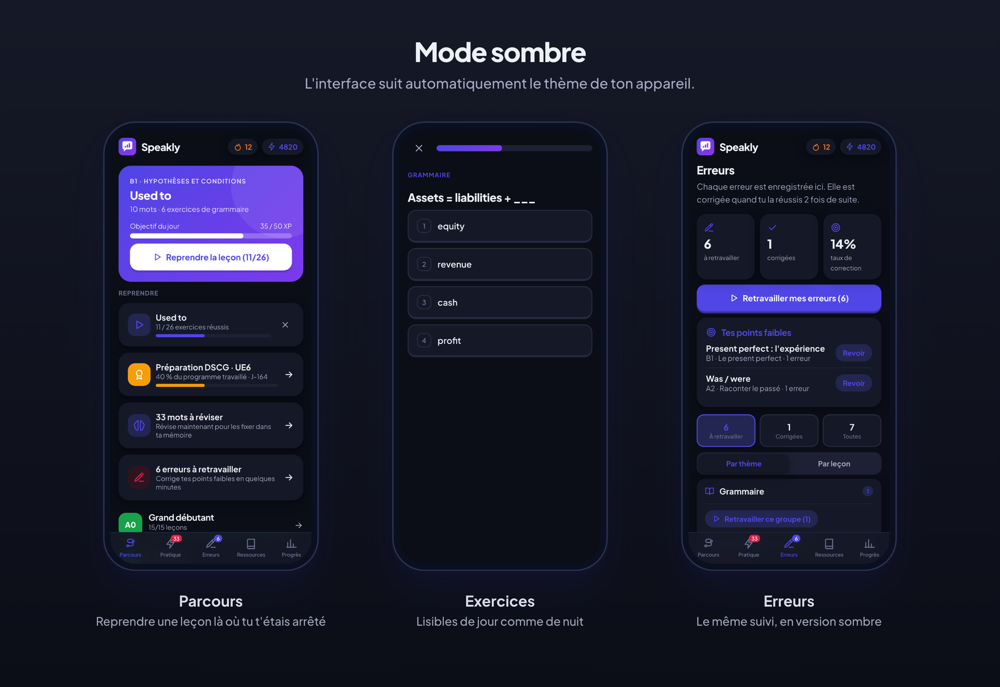

<p align="center">
  
</p>

<p align="center">
  <a href="https://tauwni.github.io/Speakly/"></a>
  <a href="https://tauwni.github.io/Speakly/presentation/"></a>
</p>

<p align="center">
  
  
  
  
  
</p>

<p align="center">
  <b>Speakly</b> est une application pour apprendre l'anglais en partant de zéro jusqu'au niveau quasi bilingue,<br>
  avec un mode complet pour préparer l'oral d'anglais du <b>DSCG</b>.<br>
  Elle fonctionne dans le navigateur, sur téléphone comme sur ordinateur, sans compte et même hors ligne.
</p>

---

## Sommaire

- [Aperçu](#aperçu)
- [Fonctionnalités](#fonctionnalités)
- [Le parcours](#le-parcours)
- [Préparation DSCG](#préparation-dscg)
- [Installer l'application](#installer-lapplication)
- [Lancer le projet en local](#lancer-le-projet-en-local)
- [Organisation du code](#organisation-du-code)
- [Remarques](#remarques)

## Aperçu

<p align="center"></p>
<p align="center"></p>
<p align="center"></p>
<p align="center"></p>
<p align="center"></p>

## Fonctionnalités

| | |
|---|---|
| **Test de niveau adaptatif** | 18 questions qui s'ajustent à tes réponses pour te placer au bon niveau, de A0 à C2. |
| **140 leçons** | Une règle expliquée en français, des cartes mémoire, le vocabulaire avec audio, puis une série d'exercices. |
| **11 types d'exercices** | QCM, écoute, dictée de mots et de phrases, traduction, phrases à remettre dans l'ordre, phrases à trous, association de paires, compréhension, lecture, prononciation au micro. |
| **Révisions espacées** | Chaque mot revient au bon moment (1, 3, 7, 16, 35 jours…) pour être retenu sur le long terme. |
| **Onglet Erreurs** | Chaque faute est gardée avec ta réponse et la bonne réponse, classée par thème ou par leçon. Elle est corrigée quand tu la réussis deux fois de suite. |
| **Reprise des sessions** | Tu quittes une leçon, un examen ou un entraînement : tu reprends plus tard exactement à la même question. |
| **Pratique** | Séance du jour, 110 verbes irréguliers, conjugaison sur 11 temps, histoires à écouter, dialogues de situation, paires de sons, nombres et heures, « corrige l'erreur », phrasal verbs, expressions idiomatiques, faux amis. |
| **Correction de l'écrit** | 14 sujets de rédaction notés sur 20 : fautes soulignées et expliquées en français, conseils et corrigé modèle. Fonctionne hors ligne, avec une analyse complémentaire en ligne facultative. |
| **Examens et certificats** | Un examen de 20 questions par niveau, certificat à partir de 80 %. |
| **Ressources** | Grammaire, lexique de plus de 1 600 mots, tableau des verbes irréguliers, guide de prononciation, référentiels CECRL et DSCG. |
| **Progrès** | Série de jours, XP, objectif quotidien, précision, maîtrise par niveau, 24 badges. |
| **Confort** | Mode sombre automatique, installation sur l'écran d'accueil, fonctionnement hors ligne, aucun compte ni publicité. |

## Le parcours

| Niveau | Nom | Ce que tu sais faire à la fin |
|:---:|---|---|
| **A0** | Grand débutant | Saluer, compter, te présenter, nommer les objets du quotidien et les premiers mots du travail. |
| **A1** | Débutant | Parler de toi au présent, décrire ton quotidien, écrire un e-mail simple, téléphoner, prendre rendez-vous. |
| **A2** | Élémentaire | Raconter au passé, comparer, te débrouiller en voyage, décrire une évolution chiffrée, participer à une réunion. |
| **B1** | Intermédiaire | Exprimer ton expérience et tes opinions, faire des hypothèses, lire des états financiers, commenter un graphique. |
| **B2** | Intermédiaire avancé | Argumenter, rapporter des propos, maîtriser le vocabulaire de l'audit, de la gouvernance, de la stratégie et des RH. |
| **C1** | Avancé | Nuancer finement, parler de marchés financiers, de normes comptables et de systèmes d'information. |
| **C2** | Maîtrise | Comprendre la presse économique, synthétiser un document et répondre à un jury avec aisance. |

## Préparation DSCG

Un mode dédié à l'épreuve **UE6 Anglais des affaires** du DSCG. Il s'active à l'inscription ou dans les réglages.

- **L'épreuve** : format, déroulement, compétences évaluées et méthode pour l'heure de préparation.
- **Les 7 thèmes du programme** : gouvernance et RSE, systèmes d'information et IA, finance, comptabilité et audit, management et ressources humaines, production, marketing et publicité.
- **Pour chaque thème, 5 étapes** : vocabulaire spécialisé, notions clés à définir en anglais, un article avec questions de compréhension, une synthèse écrite corrigée, un oral blanc.
- **Oral blanc** : préparation chronométrée (60, 20 ou 5 min), exposé avec enregistrement de ta voix, questions du jury lues à voix haute, puis auto-évaluation sur 20 à partir de cinq critères, avec la synthèse et le plan attendus.
- **33 phrases utiles** pour présenter un document, enchaîner, nuancer, conclure et dialoguer avec le jury.
- **Pensé pour partir de zéro** : chaque niveau du parcours contient une unité d'anglais professionnel qui mène progressivement au niveau B2 visé.

## Installer l'application

Ouvre **[tauwni.github.io/Speakly](https://tauwni.github.io/Speakly/)** puis :

- **iPhone (Safari)** : bouton Partager, puis « Sur l'écran d'accueil ».
- **Android (Chrome)** : menu ⋮, puis « Installer l'application ».
- **Ordinateur (Chrome ou Edge)** : icône d'installation dans la barre d'adresse.

La progression est enregistrée sur l'appareil : elle ne passe par aucun serveur.

## Lancer le projet en local

Aucune installation ni compilation : ce sont des fichiers statiques. Il suffit de les servir avec un petit serveur web :

```bash
git clone https://github.com/Tauwni/Speakly.git
cd Speakly
python3 -m http.server 8000
```

Puis ouvre http://localhost:8000.

## Organisation du code

```
Speakly/
├── index.html          Page unique de l'application
├── style.css           Design (clair et sombre)
├── icons.js            Logo et icônes SVG dessinés pour l'appli
├── app.js              Parcours, moteur d'exercices, révisions, erreurs, reprise, progrès
├── practice.js         Onglets Pratique et Ressources, examens, badges
├── check.js            Correction automatique de l'expression écrite
├── dscg.js             Mode Préparation DSCG et référentiel CECRL
├── data/
│   ├── core.js         Moteur de contenu des leçons
│   ├── a0.js … c2.js   Leçons par niveau
│   ├── more.js         Unités d'anglais professionnel
│   ├── extra.js        Verbes, dialogues, histoires, faux amis, sujets d'écriture…
│   └── dscg.js         Programme, thèmes et articles du DSCG
├── sw.js               Fonctionnement hors ligne
├── manifest.json       Installation sur l'écran d'accueil
├── presentation/       Page de présentation du projet
└── docs/images/        Images de ce README
```

## Remarques

- Le format de l'épreuve et le programme DSCG sont présentés d'après l'arrêté du 4 août 2025 (Bulletin officiel n° 32 du 28 août 2025), tel que repris par des sites de préparation. Vérifie les modalités de ta session sur le texte officiel.
- Les articles du mode DSCG sont des textes d'entraînement rédigés pour l'application, pas de vrais articles de presse.
- L'audio utilise la synthèse vocale du navigateur. La reconnaissance vocale et l'enregistrement dépendent du navigateur et de l'autorisation du micro.
- La correction en ligne, facultative, envoie le texte au service LanguageTool. Elle peut être désactivée sous le bouton « Corriger mon texte ».
